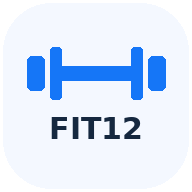
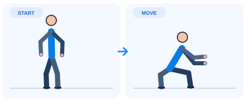
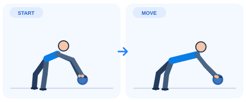

<div align="center">
  
  <h1>FIT12 — 12-Week Fitness Tracker</h1>
  <p><strong>Plan workouts. Learn exercises. Track meals. Build consistency.</strong></p>
  <p>A minimalist, mobile-first fitness tracker built as an AI-assisted learning and portfolio project.</p>
  <p>
    <a href="https://fadzlics.github.io/fit12-fitness-tracker/"><strong>🚀 Launch Live App</strong></a>
    &nbsp;·&nbsp;
    <a href="https://github.com/FadzliCS/fit12-fitness-tracker">💻 View Source Code</a>
  </p>
  <p>
    
    
    
    
    
  </p>
</div>

---

## 📖 About the project

**FIT12** is a 12-week fitness planning and progress-tracking web app. It combines simple exercise demonstrations, home and gym workout schedules, Malaysian-friendly example meals, and daily check-ins in a clean white-and-blue interface.

It started with a personal goal: turn a fitness routine into something practical and easy to follow on a phone. I used **AI assistance to help build the application**, then set up the GitHub repository, published it with GitHub Pages, and installed/tested it as a Progressive Web App (PWA) on an Android phone.

> **Status:** Live portfolio/learning project. The app is intended for personal tracking and education, not medical diagnosis or individualized medical advice.

## ✨ Features

| Feature | What it does |
| --- | --- |
| 🗓️ **12-week plan** | Select any week and day to see a scheduled activity. |
| 🏋️ **Workout planner** | Home and gym routines with exercise names, sets, reps and durations. |
| 🖼️ **Exercise demo library** | Two-position SVG illustrations and step-by-step English instructions. |
| ⏱️ **Rest timer** | Helps time rest periods between exercises. |
| 🍽️ **Diet planner** | Seven-day Malaysian-friendly meal examples with estimated calories and protein. |
| 📈 **Progress tracker** | Log weight, waist, calories, protein, steps, water and notes. |
| ✅ **Daily checklist** | Mark completed workouts and meals. |
| 📱 **Installable PWA** | Add FIT12 to a supported mobile device's home screen. |
| 📴 **Offline-ready** | Service worker caches app assets after an initial online load, subject to browser support. |
| 💾 **Local data + backup** | Progress stays in the device browser; JSON export/import helps preserve records. |

## 📱 Real Android app preview

The gallery below shows **Home**, **Diet** and **Progress** from a real Android installation of FIT12. The status bar and personal device information have been removed from the preview.


*See the [live application](https://fadzlics.github.io/fit12-fitness-tracker/) for the interactive version.*

## 👀 Exercise illustration previews

The exercise library contains simple **START → MOVE** visual guidance. These images are examples from the actual project files.

| Bodyweight Squat | FUYOGI Ab Roller (generic illustration) |
| :---: | :---: |
|  |  |

**Note:** The ab-roller illustration is generic; users should consult the manual for their exact device. The app includes a conservative, medically gated plan for exercises that load the arms when symptoms are present.

## 📲 Try FIT12

**Live application:** https://fadzlics.github.io/fit12-fitness-tracker/

### Install on Android

1. Open the live link in **Chrome**.
2. Open the **⋮** menu and choose **Install app** or **Add to Home screen** if offered.
3. Launch **FIT12** from the app drawer or home screen.
4. Open **Settings** to adjust your own starting weight, goals, daily calorie target and protein target.

On desktop, a supported browser may also show an **Install** button.

> **Data note:** Progress on different devices does **not** sync automatically. Export a backup before switching devices or clearing app storage.

## 🛠️ Tech stack

- **HTML5** — application layout and semantic structure
- **CSS3** — minimalist, responsive white-and-blue interface
- **Vanilla JavaScript** — view navigation, exercise information, checklists and progress logic
- **SVG** — lightweight two-position exercise illustrations
- **Web App Manifest** — installation metadata and app icons
- **Service Worker** — offline asset caching
- **Browser localStorage + JSON backup** — local-first data storage
- **GitHub + GitHub Pages** — source control and static-site deployment

**No backend or paid database is required** for this version.

## 📁 Project structure

```text
fit12-fitness-tracker/
├── index.html                 # UI, styling and app logic
├── manifest.webmanifest       # PWA identity and icon configuration
├── sw.js                      # Offline service worker
├── exercises/                 # Exercise illustrations (SVG)
├── icons/                     # PWA icon assets
├── README.md                  # Project documentation
└── PANDUAN_GITHUB_MY.txt      # Malay-language publishing guide
```

## 💻 Run locally

1. Download or clone the repository:
   ```bash
   git clone https://github.com/FadzliCS/fit12-fitness-tracker.git
   ```
2. Open `index.html` for a basic preview.
3. For PWA installation/service worker testing, serve the folder on **localhost** (or over HTTPS). One option, if Python is installed:
   ```bash
   python -m http.server 8000
   ```
4. Open `http://localhost:8000` in the browser.

The production version is published from the `main` branch via **GitHub Pages**.

## 🔒 Privacy & health considerations

- The repository and GitHub Pages site are **public**; do not commit personal health records or exported backups.
- This public demo starts with **example values** (80 kg starting weight and 75 kg goal). Set personal goals within the app instead of hardcoding them into the public repository.
- Logs are stored **locally in the visitor's browser**, not in GitHub. Browser data can be deleted or become unavailable, so export backups regularly.
- Calorie and protein values are **illustrative estimates**, not precise nutritional measurements.
- The app includes a starter routine with lower-impact activities and restrictions on upper-body loading or use of the FUYOGI roller until appropriate medical clearance where relevant.

## 🎓 What I learned

This is my **first published web-app portfolio project** and a hands-on step into software development while studying Mathematics and exploring IT, programming, Data Analytics and Data Science.

Through building and publishing FIT12, I practised:
- Structuring a basic web application
- Organizing files and documentation in a GitHub repository
- Using GitHub Pages for deployment
- Understanding how an installable PWA works
- Testing an app on both desktop and Android
- Working with AI-generated code, reviewing results, and identifying improvements

### 🤝 AI-assisted development disclosure

FIT12 was developed **with substantial AI assistance**. I contributed the product idea, requirements, design preferences, testing feedback, GitHub setup and deployment. I am continuing to study the generated HTML, CSS and JavaScript so I can make and explain improvements independently.

## 🧭 Possible next improvements

- [x] Add genuine mobile screenshots to this README
- [ ] Improve accessibility and exercise-demo clarity
- [ ] Add a statistics dashboard for weekly training consistency and weight trends
- [ ] Add configurable meal templates and more flexible targets
- [ ] Add automated checks and further cross-device testing

---

<div align="center">
  <strong>FIT12</strong> — Small steps. Consistent progress. 💙
  <br />
  <a href="https://fadzlics.github.io/fit12-fitness-tracker/">Open App</a> ·
  <a href="https://github.com/FadzliCS/fit12-fitness-tracker">Repository</a>
</div>
